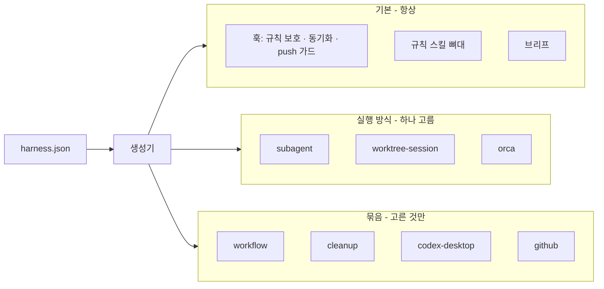
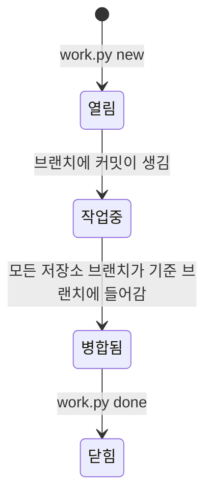

# 선택형 구조 개선 설계

- 상태: 설계 (구현 전)
- 작업 브랜치: `feat/선택형-구조` (워크트리 `~/.harness-template-dev`)
- 근거: 이 템플릿과, 이 템플릿보다 먼저 실전에서 굴린 프로젝트 하네스(이하 「실전 하네스」)를 하네스 기능만 놓고 비교한 결과

## 1. 왜 바꾸나

지금 템플릿은 **사용자가 고르지 않은 것을 기본으로 깐다.**

| 무엇 | 지금 | 근거 |
| --- | --- | --- |
| Orca | 빠른 셋업에서 묻지 않고 켠다. 없으면 설치를 권한다. 켜지면 코드 작업자를 서브에이전트로 띄우지 않는다(사실상 독점) | `bootstrap.py` `simple_interview(use_orca=True)` · `generate.py` `dispatch_table` |
| Orca 분기 | `orca_on(cfg)` 가 생성기 · 셋업 곳곳에 흩어져 있다 | `grep -n orca_on harness/scripts/*.py` |
| node 22 | 스택 · 엔진과 상관없이 항상 설치 대상 | `install.sh` 머리 주석 · `node_major` |
| 정리 · Codex 데스크톱 연동 | 개인 환경에 맞춘 기능(크롬 복제본 · `/tmp` 찌꺼기 · 앱 프로젝트 귀속)이 기본 탑재 | `cleanup_temp.py` · `codex_project_binding.py` |
| 작업 추적 | 사람이 고치는 `상황판.md` · 이슈. 기계가 상태를 모른다 | `start` 스킬 1절 |
| 과제 단위 | 과제 1 = 저장소 1. 여러 저장소에 걸친 변경을 묶을 단위가 없다 | `task-brief` 스킬 「쪼개는 기준」 |

실전 하네스에서 검증된 것(작업 단위 · git 에서 계산하는 상태 · 훅 개선)은 템플릿에 없다.
반대로 실전 하네스는 **절차가 깊어서 작업보다 절차가 더 오래 걸린다**: 그 단점은 가져오지 않는다.

## 2. 원칙

1. **기본은 최소, 나머지는 사용자가 고른 것만.** 고르지 않은 기능은 파일 · 규칙 문장 · 설치가 하나도 생기지 않는다.
2. **기능은 묶음(pack)으로 붙이고 뗀다.** 묶음이 자기 파일 · 문장 · 도구 목록을 들고, 생성기는 조립만 한다. `if orca` 같은 분기를 흩뿌리지 않는다.
3. **절차가 작업보다 무거우면 안 된다.**
   - 사람이 체크하는 단계를 만들지 않는다. 상태는 git 이 말해 준다(브랜치 · 커밋 · 병합).
   - 작업 하나에 사람이 치는 명령은 **여는 것 · 닫는 것 두 개**가 기본이다.
   - 문서 틀은 채울 칸을 최소로. 빈 칸이 있어도 진행을 막지 않는다.
   - 확인창은 되돌리기 어려운 것(규칙 변경 push · 강제 push)에만.
4. **실전 하네스는 실험장, 템플릿은 검증된 것만.** 실전에서 굳은 것을 일반화해 올린다.

## 3. 목표 구조



```json
{
  "runner": "subagent",
  "engines": ["claude"],
  "packs": ["workflow"],
  "workflow": { "prefix": "T", "dir": "docs/작업" }
}
```

### 3-1. 실행 방식 어댑터 (Orca 선택화)

- 어댑터 = `subagent` · `worktree-session`(`claude --worktree` · Codex 앱 워크트리) · `orca`.
- 각 어댑터가 들고 있는 것: 띄우기 · 중간 지시 · 정리 명령, 「맡기는 방법」 표 문장, 필요한 도구 목록, 생성할 파일(Orca 면 `scripts/orca-*.sh`).
- 생성기 · `finish_worker.py` · 설치 도구 표는 어댑터에 묻기만 한다. `orca_on` 직접 분기를 없앤다.
- 설치 질문에 「작업자를 어떻게 띄울까요」가 들어간다. **Orca 는 골랐을 때만 설치한다.**
- 이전: `update` 가 `orca.enabled: true` → `runner: "orca"`, `false` → `runner: "subagent"` 로 옮긴다. 옛 칸은 지운다.

### 3-2. workflow 묶음 (실전 하네스에서 가져오되 얕게)

**작업 하나 = 번호 하나 = 문서 한 장 + 저장소별 워크트리.**

| 명령 | 하는 일 |
| --- | --- |
| `work.py new <제목> [저장소…]` | 번호를 받고(원격이 있으면 push 로 잠금) 문서 한 장 · 저장소별 워크트리(`.work/<번호-제목>/<저장소>`, 같은 브랜치 이름)를 만든다 |
| `work.py` | 지금 상태 한 화면(계산) |
| `work.py done <번호>` | 안전 조건 확인 → 워크트리 정리 → 문서를 완료 자리로 |

상태는 **사람이 체크하지 않고 계산한다.** 기본 상태 4개:



- 「누구 차례」는 상태에서 나온다: `병합됨` 인데 안 닫혔으면 「닫을 차례」, 커밋은 있는데 원격에 없으면 「올릴 차례」.
- **단계(stages)는 기본으로 없다.** 게이트가 꼭 필요한 팀만 `workflow.stages` 배열로 더한다(선택). 더해도 체크는 가능한 한 git 신호로 판정한다.
- 번호 겹침은 원격이 있을 때만 의미가 있다. 로컬 전용이면 그냥 센다.
- 문서 틀 칸: 목표 · 대상 저장소 · 완료 조건 · 메모. 그 밖은 쓰고 싶으면 쓴다.
- 이 묶음을 켜면 `상황판.md` 손 체크리스트 대신 계산된 상태를 쓴다(`start` 스킬도 그것을 읽는다).

가져오지 않는 것: 초안 → 착수 분리, 8단계 체크, 완료 기록 필수 칸 검사, 월별 done 폴더, 규격 문서 겹침 검사(필요해지면 나중에 선택).

### 3-3. 훅

| 훅 | 바꾸는 것 |
| --- | --- |
| 규칙 보호 | 지금 방식 유지(격리 워크트리는 안 묻고, 기준 브랜치 push 때 바뀐 규칙 파일 목록으로 한 번) |
| 시작 동기화 | 받아온 커밋 중 **규칙이 바뀐 파일을 이름으로** 알린다 · workflow 를 켰으면 열린 작업 한 줄 |
| 종료 | 지금은 같은 상태여도 턴마다 막는다 → **지문이 같으면 다시 막지 않는다** |
| 고친 뒤 할 일 알림 | `harness.json` 을 고치면 생성기, 훅 · 플러그인을 고치면 점검(doctor)을 세션에 한 번 알린다(막지 않음). 생성된 하네스에는 시험 폴더가 없어 「테스트 돌려라」 대신 이것으로 바꿨다 |
| 명령 해석 | 훅마다 따로 두지 않고 공용 모듈 하나(heredoc · `sh -c` · `cd X &&` 위치 추적, 모르면 묻는다) |

### 3-4. 설치 최소화 · 묶음 분리

- 기본 설치는 git · python 만. node 는 고른 엔진 · 스택이 요구할 때만.
- `cleanup_temp.py` 의 크롬 · `/tmp` 정리 → `cleanup` 묶음. `finish_worker.py` 의 기본 안전 조건(변경 없음 · 원격에 없는 커밋 0 · 세션 idle)은 기본에 남긴다.
- Codex 데스크톱 프로젝트 귀속 → `codex-desktop` 묶음.
- GitHub 원격 · 라벨 → `github` 묶음(지금도 선택이지만 묶음 형식으로 맞춘다).

### 3-5. 설치 질문

**이름 · 엔진 · 작업자 실행 방식 · 작업 흐름(workflow) 쓸지** 4개. 호칭은 기본값을 쓰고 `--detail` 에서만 묻는다.
workflow 질문의 기본 답은 「쓴다」.

### 3-6. 그 밖의 단점 정리

| 단점 | 고치는 법 |
| --- | --- |
| 이름 · 호칭을 바꾸면 머리말 · 본문에 낡은 값이 남고 `doctor` 가 모른다 | 직전 값을 manifest 에 남기고 `doctor` 가 낡은 자리를 찾는다. `description:` 은 생성기가 다시 쓴다 |
| `bootstrap.py` · `generate.py` 가 크다 | 질문 · 도구 설치 · 저장소 · 묶음별 생성으로 나눈다 |
| 규칙 스킬이 거의 빈칸 | 프로젝트와 무관한 규칙(측정 · 판정 · 보고 형식, 충돌 경고, 결정 요청 형식)은 뼈대에 미리 채운다. 얕게: 한 스킬 한 화면 |

## 4. 진행 순서

커밋 하나 = 아래 한 줄. 각 단계는 `python3 -m unittest discover -s tests` 통과 + 바뀐 동작의 테스트를 더해서 끝낸다.
시작 시점 기준선: 287 개 통과 · 1 건너뜀 (2026-10-27).

1. 실행 방식 어댑터 + Orca 선택화 + 옛 설정 이전 (`update` 이전 테스트 포함)
2. 훅 정리 (규칙 변경 알림 · 종료 지문 · 테스트 알림 · 공용 명령 해석)
3. 설치 최소화 · `cleanup` · `codex-desktop` 묶음 분리
4. workflow 묶음 (`work.py new` · 상태 계산 · `done`)
5. 설치 질문 4개 · README 갱신
6. 큰 파일 나누기 · 낡은 이름 검출 · 스킬 뼈대 채우기

엔진 3 × 실행 방식 3 조합을 두 번 돌리는 테스트로 기존 「엔진 × Orca」 조합 테스트를 바꾼다.

## 5. 결정 (2026-10-28)

| 무엇 | 결정 |
| --- | --- |
| 실행 방식 기본값 | subagent (설치할 것이 없고 두 엔진 다 된다) |
| workflow 작업 번호 접두어 기본 | `T` |

## 6. 진행

| 단계 | 상태 |
| --- | --- |
| 1. 실행 방식 어댑터 · Orca 선택화 · 옛 설정 이전 | 완료 `feat(runner)` (시험 298 통과 · 1 건너뜀) |
| 2. 훅 정리 (규칙 변경 이름 알림 · Stop 지문 · 고친 뒤 할 일 알림 · 공용 명령 해석) | 완료 `feat(hooks)` (시험 313 통과 · 1 건너뜀) |
| 3 ~ 6 | 남음 |
